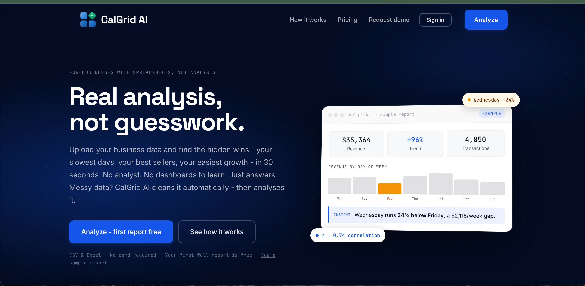

# CalGrid AI

**AI-powered data analytics for small businesses.**
Upload a spreadsheet and get plain-English insights, trends, forecasts, and a report you can share, no analyst required.

🔗 **Live:** [calgridai.com](https://calgridai.com)
👤 **Built by:** Mohammed Bello Ibrahim, founder and lead engineer

> The production codebase is private. This repo documents the product, architecture, and engineering decisions.

---

## The Problem

Small businesses sit on sales sheets, inventory logs, and customer data but can't afford a data analyst. Generic BI tools are too complex; generic chatbots don't understand their numbers.

## The Solution

CalGrid AI ingests a business's own data, detects what each column means, runs the analysis, and explains the results in language an owner can act on.



<!-- Next: add screenshots/onboarding.png and screenshots/report.png -->

---

## Features

| Feature | Details |
|---|---|
| Guided onboarding | 4 quick questions (industry, goal, decision) so the report is written for that business |
| Automatic data cleaning | Fixes numbers stored as text, drops unusable columns, scores data quality |
| Local-first processing | Files are parsed and profiled in the browser; raw data never leaves the user's device |
| AI insights | Plain-English findings generated with the Claude API |
| Multi-file analysis | Analyze several datasets together (Premium) |
| Google Sheets import | Connect a sheet directly, no export needed |
| Forecast cards | Forward-looking trend projections |
| Industry presets | One-click context for common business types |
| Shareable reports | Public report links for partners or investors |
| Email summaries | Automated insight digests |
| Insight feedback | Users rate insights to improve quality |
| Ask your data (RAG) | Ask questions across every saved report and get cited answers (Pro & Premium) |

## Architecture

```
User ──► Next.js 16 / React 19 app (Vercel)
           ├── Auth: Clerk (email + Google OAuth)
           ├── Data: Supabase (Postgres)
           ├── Analysis engine: column typing → measure detection → trends/forecasts
           ├── LLM layer: Claude API for narrative insights
           ├── RAG: Voyage embeddings → pgvector (HNSW) → grounded, cited answers
           ├── Observability: Langfuse tracing via OpenTelemetry
           ├── Billing: Stripe (Single / Pro / Premium)
           ├── Email: Resend
           └── Charts & exports: Chart.js, jsPDF
```

## Ask Your Data (RAG)

Pro and Premium users can ask a question like *"Which month had my highest revenue?"* and get an answer drawn from every report they've saved, with links to the reports it came from.

```
SAVE TIME (once per report)                QUESTION TIME
report ─▶ ~9 passages ─▶ embed (Voyage)    question ─▶ embed (Voyage)
                │                                  │
                ▼                                  ▼
   report_chunks (Postgres + pgvector) ─▶ nearest 8 passages for THIS user
                                           (similarity floor drops weak matches)
                                                   │
                                                   ▼
                              LLM answers ONLY from these, as structured JSON with citations
```

**Key design decisions**

- **Retrieve computed figures, not raw rows.** Embedding sales rows would make the model guess totals from a sample. The engine computes exact aggregates first, and those are what get retrieved.
- **pgvector instead of a separate vector database.** Small data, lives next to the source reports, deletes cascade, and it inherits the existing security model.
- **Grounding:** a similarity floor, an answer-only-from-sources prompt with an explicit "not in your reports" path, and structured output with citations.
- **Security:** user id comes from the verified session (never the request body), the search function is server-only, row-level security on every table, spreadsheet text treated as data (prompt-injection defence), and 20 questions per hour.
- **Observability:** every question is one Langfuse trace (embed → retrieve → generate) with latency, tokens, cost, and similarity scores. Customer question and answer text is not sent to the tracing service.

**Evaluation (measured, not eyeballed)**

A fixed eval seeds five synthetic reports for two businesses with planted facts, then runs 13 questions through the real pipeline. Two questions are unanswerable on purpose, and one is a prompt-injection test (a planted "ignore all previous instructions" note in the data).

| Metric | What it checks | Result |
|---|---|---|
| Retrieval recall | Did search surface the passages that hold the answer? | 100% |
| Answer accuracy | Is the answer right? (LLM-as-judge) | 13 / 13 |
| Groundedness | Is every number in the answer from the sources? | 100% |
| Abstention accuracy | Does it say "not in your reports" exactly when it should? | 100% |
| Median latency | | ~5 s |

Scoring retrieval and generation separately shows what to fix: a wrong answer with good retrieval is a prompt problem; with bad retrieval it's a search problem.

**Next:** hybrid search (keyword + vector) for exact names, a reranker, and a tool-calling agent for questions that need fresh computation.

---

## Engineering Highlights

- **Led engineering to production:** auth, payments, data pipeline, LLM layer, and deployment
- **Auth migration:** moved to Clerk production auth with Google OAuth
- **Privacy by design:** parsing, cleaning, and profiling run client-side, so raw business data isn't uploaded
- **Secrets hygiene:** all API keys kept out of source control, with a placeholder-only `.env.example`
- **Tiered monetization:** three Stripe plans with feature gating per tier
- **Security audit (Oct 2026):** reviewed authentication, authorization, secret handling, and API exposure
- **Data quality problem solving:** found that survey ranking columns named like "price" were being misread as money values; redesigning measure detection and trend logic to fix it

## Roadmap

- [ ] Smarter measure detection for survey and ranking data
- [ ] Per-session chat history
- [ ] PDF ingestion for businesses without spreadsheets
- [ ] White-label PDF reports for agencies
- [ ] Progressive Web App

## Validation

Early user testing with a local small business owner in Peterborough, Ontario shaped the onboarding and insight format.

---

📫 [LinkedIn](https://www.linkedin.com/in/mohammed-bello-ibrahim-7521b62a2/) · [Portfolio](https://mohammed-bello-ibrahim.vercel.app)
